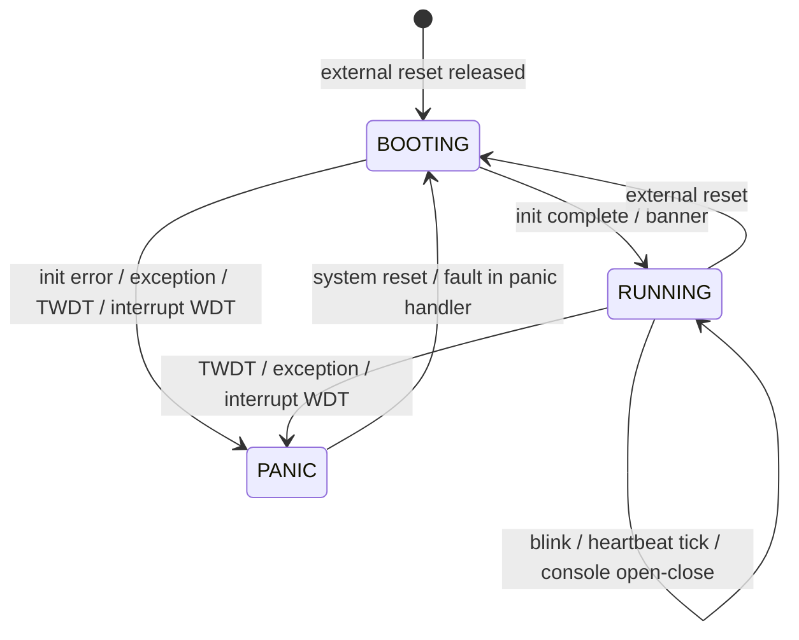
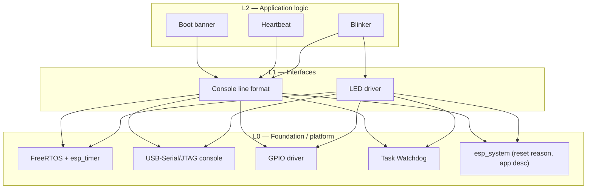

# helloworld-esp — Functional Specification Document (FSD)

Provenance tags: `[user]` stated by the user · `[derived]` consequence of a
`[user]` requirement · `[pack:esp32]` proposed by the ESP32 domain pack and
accepted by the user · `[tooling]` harvested from the project's pinned build
tooling. Every requirement below is `status: approved`.

## 1. System Overview

helloworld-esp is the smallest ESP32-S3 firmware that still has something to
verify: it announces itself on boot, proves it is alive once a second, blinks
the onboard LED, and resets itself if it ever stops doing so. Its purpose is to
exercise the closed loop — define, build, flash, observe, verify — end to end on
the testbench with a device whose correct behaviour is unambiguous.

**Goals** `[user]`
- A boot banner identifying the image (version) and why the chip last reset.
- A periodic heartbeat on the console.
- A visible 1 Hz blink of the onboard LED.

**Goals** `[pack:esp32]`
- A task watchdog that turns a stalled task into a reset with a recorded reason.

**Non-goals** `[user]`
- No WiFi, BLE, or any other radio. No network services of any kind.
- No OTA update path. No persistent storage (NVS is not used).
- No runtime input: the firmware accepts no commands from any interface.

**Users.** The developer running the loop; the testbench as automated observer.

**High-level flow.** Reset → boot banner on the USB-Serial/JTAG console →
heartbeat line every 1 s and LED toggle every 500 ms, indefinitely → on a task
stall, watchdog panic → reset → banner reporting `TASK_WDT`.

## 2. System Architecture

### 2.1 Logical Architecture

One device, one observer. The DUT writes text lines to its native USB console;
the testbench (or a local PC) reads them. The LED is the only other output.
Nothing flows into the device after flashing.

```text
 ESP32-S3 DUT ──USB-Serial/JTAG (log lines)──▶ testbench / host
     │
     └──GPIO21 (active-low)──▶ onboard user LED ──light──▶ person
```

### 2.2 Hardware / Platform Architecture

**Board** `[user]`: Seeed Studio **XIAO ESP32S3 Sense** (ESP32-S3R8, 8 MB
flash, 8 MB octal PSRAM, which this firmware does not use — CON-06), with its camera/microphone/microSD expansion board.
Powered and observed through its single USB-C port, which is the native
USB-Serial/JTAG controller. The onboard user LED is on GPIO21 and is
active-low: driving the pin low lights it `[derived]` from the board
documentation.

Constraints the build reads — each is a number a toolchain would otherwise take
from a default:

| ID | Constraint | Source |
|---|---|---|
| CON-01 [Must] | The firmware shall be built for target `esp32s3` with ESP-IDF **v6.0.2** (container `espressif/idf:v6.0.2`). | `[user]` target · `[tooling]` version |
| CON-02 [Must] | The image shall be configured for **8 MB** flash. A unit with less than 8 MB flash is not a supported target. | `[user]` |
| CON-03 [Must] | The partition table shall be the single-factory-app layout: `nvs` at 0x9000 (24 KB), `phy_init` at 0xF000 (4 KB), `factory` at 0x10000 (1 MB). The application image shall not exceed 1 MB. | `[derived]` from the no-OTA non-goal |
| CON-04 [Must] | The primary console shall be the USB-Serial/JTAG controller. | `[user]` |
| CON-05 [Must] | The LED shall be the onboard user LED on **GPIO21**, driven as a push-pull output, with low = lit. | `[user]` pin · `[derived]` polarity |
| CON-06 [Must] | PSRAM shall not be enabled; the firmware uses internal RAM only. | `[user]` |

| ID | Precondition · stimulus | Expected observation | Must NOT happen | Tier |
|---|---|---|---|---|
| CON-01 | Release artefact · `esptool.py image_info` and app-description dump | Chip ID ESP32-S3; `idf_ver` equals `v6.0.2` | Any other chip ID or IDF version, including a suffixed one (`v6.0.2-dirty`, `v6.0.2-1-g<hash>`) | host |
| CON-02 | Release artefact · `esptool.py image_info`; DUT · `esptool.py flash_id` | Image header flash size 8 MB; DUT reports ≥ 8 MB | Header size ≠ 8 MB; DUT reports < 8 MB | target |
| CON-03 | Release artefact · read partition table and app size | Table matches the offsets/sizes above; app ≤ 1 048 576 bytes | Extra or moved partitions; app > 1 MB | host |
| CON-04 (a) | Release artefact · read its generated `sdkconfig` | `CONFIG_ESP_CONSOLE_USB_SERIAL_JTAG=y` and `CONFIG_ESP_CONSOLE_UART_NUM=-1` | Any UART primary console (`CONFIG_ESP_CONSOLE_UART_DEFAULT` or `_UART_CUSTOM` set) | host |
| CON-04 (b) | DUT flashed, port opened with DTR and RTS low · reset DUT | Banner (FR-BOOT-01) arrives on the USB-Serial/JTAG port | No banner on the USB-Serial/JTAG port (UART0 is not observed; a UART-primary image is failed by CON-04 (a)) | target |
| CON-05 (a) | Host test · LED driver pure core maps `on` and `off` to pin levels | `on` → 0, `off` → 1 | `on` → 1 | host |
| CON-05 (b) | Review of the LED driver source | GPIO21 configured as push-pull output and driven high before the first blink | Any other pin; open-drain; LED lit before the first blink | other |
| CON-06 | Release artefact · read the generated `sdkconfig` | `CONFIG_SPIRAM` is not set | `CONFIG_SPIRAM=y` | host |

Two further values the build reads are normative in their own chapters: the
TWDT timeout of **5 s** with panic on timeout (FR-WDT-01, `CONFIG_ESP_TASK_WDT_TIMEOUT_S`)
and fault injection **`none`** in release images (FR-BUILD-01,
`CONFIG_HELLO_FAULT_STALL_TASK`). Taken from ESP-IDF defaults and relied on by the
state model `[tooling]`: both idle tasks subscribed to the TWDT, and the interrupt
watchdog enabled at **300 ms**, and the bootloader's RTC watchdog at **9000 ms**
until the application starts.

### 2.3 Software Architecture

ESP-IDF on FreeRTOS. `app_main` emits the banner, then starts two tasks — the
**blink task** and the **heartbeat task** — each subscribed to the Task Watchdog
Timer (TWDT). No persistence; every boot starts from the same state. The version
string is the ESP-IDF project version taken from `git describe` at build time.

#### State model — device lifecycle

States: **BOOTING** (reset released, before the banner), **RUNNING** (banner
emitted, both tasks scheduled), **PANIC** (panic handler executing). There is
no persistent state: nothing survives a reset except the hardware reset-reason
register.

The transition table is normative; the diagram below is generated from it and
loses to it on disagreement.

| ID | From | Event | Guard | To | Action | Limit | Verified by |
|---|---|---|---|---|---|---|---|
| LIFE-T1 | any | External reset released (power-on, EN, USB-JTAG, brownout) | — | BOOTING | Bootloader starts the app | — | FR-BOOT-01 |
| LIFE-T2 | BOOTING | Initialisation complete | — | RUNNING | Emit banner; start blink and heartbeat tasks; subscribe both to TWDT | Banner ≤ 3000 ms after reset | FR-BOOT-01 |
| LIFE-T3 | BOOTING | Initialisation error (any `esp_err_t` ≠ `ESP_OK`) | — | PANIC | Abort with the error name on the console | — | review only (tier other) |
| LIFE-T4 | RUNNING | Blink period elapsed | — | RUNNING | Toggle LED; emit LED line | 500 ms | FR-LED-01 |
| LIFE-T5 | RUNNING | Heartbeat period elapsed | — | RUNNING | Emit heartbeat line | 1000 ms | FR-HB-01 |
| LIFE-T6 | BOOTING, RUNNING | TWDT timeout (blink, heartbeat or an idle task starved) | — | PANIC | Print panic report naming the starved task | 5 s | FR-WDT-01 |
| LIFE-T7 | BOOTING, RUNNING | CPU exception, `abort()` or interrupt-watchdog timeout | — | PANIC | Print panic report with backtrace | — | review only (tier other) |
| LIFE-T8 | PANIC | Panic report complete | — | BOOTING | System reset | ≤ 1 s | FR-WDT-01, FR-WDT-03 |
| LIFE-T9 | any | Host opens or closes the console port | DTR and RTS low | unchanged | Ignored | — | NFR-WDT-05 |
| LIFE-T10 | PANIC | CPU exception or watchdog while the panic handler runs | — | BOOTING | Chip reset without completing the report (ESP-IDF panic re-entry) | — | review only (tier other) |
| LIFE-T11 | any | Host opens the console port | DTR or RTS asserted | outside the model | Chip held in reset or strapped into download mode; an external reset (LIFE-T1) when released | — | none: an observer fault (Method `standards/testing.md` P-SERIAL) |
| LIFE-T12 | BOOTING | RTC watchdog timeout (armed by the bootloader, disarmed when the app starts) | — | BOOTING | Chip reset with no panic report; next banner reports `reset_reason=WDT` | 9000 ms | review only (tier other) |

**Completeness.** The firmware has no inputs other than its own timers, the
TWDT, the interrupt watchdog (ESP-IDF default, enabled), the bootloader's RTC
watchdog (LIFE-T12, BOOTING only), CPU exceptions, reset,
brownout, and the console port's open/close. A CPU exception, `abort()` or
interrupt-watchdog timeout is possible in every state: LIFE-T7 covers BOOTING and RUNNING,
LIFE-T10 covers PANIC. Opening the port with DTR or RTS asserted is an external
reset, not firmware behaviour (LIFE-T11). Every other (state × event) pair is impossible by
construction. A timer event in BOOTING or PANIC is impossible because the timers
are started at LIFE-T2 and stop with the scheduler. A TWDT timeout is
possible in BOOTING as well as RUNNING, because ESP-IDF subscribes both idle tasks
before `app_main` (LIFE-T6). A software
reset is impossible because the firmware never calls `esp_restart()`; the only
software-initiated reset is the panic handler's, LIFE-T8.

**Prohibited transitions.** RUNNING → BOOTING other than through PANIC
(LIFE-T6/T7 → LIFE-T8) or an external reset (LIFE-T1: power-on, EN, USB-JTAG,
brownout); anything else is a silent reboot. PANIC → RUNNING without a reset.



### 2.4 Component Layering



- **L2 Application logic** — Boot banner (§5), Heartbeat (§6), Blinker (§7):
  the project's own decisions about what to say and when.
- **L1 Interfaces** — Console line format (§8): the line grammar a host parses,
  owned by this project. LED driver (§9): the mapping from on/off to a GPIO21
  level.
- **L0 Foundation** — ESP-IDF platform services configured, not implemented
  (§10), and the Task Watchdog (§11). Tested transitively.

Dependencies point strictly downward. The source layout that mirrors these
layers is a Method rule: [`../Method/project/architecture.md`](../Method/project/architecture.md).

## 3. Implementation Phases

### 3.1 Phase 1 — Alive on the console

- **Scope:** boot banner with reset reason, heartbeat, console line format,
  platform constraints.
- **Deliverables:** firmware image meeting CON-01…CON-04; host-tier tests for
  the pure formatters; target-tier tests on the testbench.
- **Exit criteria:** CON-01…CON-04, FR-BOOT-01, FR-BOOT-03, FR-HB-01…NFR-HB-04
  pass, and FR-LOG-01, FR-LOG-02 pass for the banner and heartbeat lines (the
  LED and fault lines arrive in Phase 2).
- **Depends on:** a testbench slot with the XIAO ESP32S3 Sense connected by USB-C,
  commissioned (journey Phase 2). Nothing from this FSD.
- **Depends on (external):** FR-BOOT-01 ("exactly one banner" per reset) and
  FR-HB-02 (b) (ten heartbeats from one boot) need one bench reset to cause exactly
  one chip reset, with that boot captured from its first line. The testbench does
  not do this yet (a change request to the testbench); until it does, both are not
  done and Phase 1 cannot exit.

### 3.2 Phase 2 — Blink, watchdog, versioned release

- **Scope:** blinker and LED driver, Task Watchdog and fault-injection build,
  version from git tag, release-image hygiene, radio silence.
- **Deliverables:** firmware meeting CON-05; fault-injection image variant;
  tag `v0.1.0`; human acceptance of the physical blink (FR-LED-03).
- **Exit criteria:** CON-05, CON-06, FR-LED-01…FR-LED-03, FR-WDT-01…NFR-WDT-05,
  FR-BOOT-02, FR-BUILD-01, NFR-SEC-01 pass, and FR-LOG-01, FR-LOG-02 pass for the
  LED and fault lines.
- **Depends on:** Phase 1, through three routes:
  - the console Phase 1 delivers (CON-04, FR-LOG-02 grammar) — FR-LED-01, FR-LED-02,
    FR-WDT-01…NFR-WDT-05, FR-BOOT-02 and the LED and fault lines of FR-LOG-01/02;
  - the release artefact Phase 1's build produces (CON-01) — CON-06, FR-BUILD-01,
    NFR-SEC-01 (a), and the host tier — CON-05 (a);
  - no firmware observation at all — CON-05 (b) by review, FR-LED-03 by a person at
    the board, NFR-SEC-01 (b) by the testbench BLE scan.
- **Depends on (external):** two exit criteria rest on abilities neither phase
  delivers:
  - NFR-WDT-05 needs the testbench to close a slot's console port for 60 s and
    reopen it with DTR/RTS low, without a reset (a change request to the testbench);
    until it can, NFR-WDT-05 is not done and Phase 2 cannot exit;
  - FR-WDT-01…FR-WDT-03 need the console to capture the boot after a
    firmware-initiated (panic) reset from its first line, proven by commissioning
    (debugging-agenda item 5, closed 2026-10-18). A single bench reset is not needed: after a flash or a
    bench reset the boot that reaches the fault line runs undisturbed, and each
    reset the fault causes is a CPU reset that keeps the console attached.

## 4. Risks, Assumptions & Dependencies

| Risk | Likelihood | Impact | Mitigation |
|---|---|---|---|
| A chip reset re-enumerates the native USB device and output emitted before the host reopens the port is lost, so the banner is unobservable | Medium | High (FR-BOOT-01, FR-WDT-02 unverifiable) | Debugging-agenda item for commissioning; observe with the testbench serial monitor, which reconnects and opens with DTR/RTS low |
| Opening the console with DTR or RTS asserted halts the chip (download mode / held in reset), reading as a firmware hang | High | Medium | Every observer opens the port with both lines low — Method `standards/testing.md` P-SERIAL |
| The USB-Serial/JTAG console blocks when no host reads, starving a watchdog-subscribed task | Medium | High | NFR-WDT-05 makes the behaviour normative and tested |
| GPIO21 is also the microSD chip select on the Sense expansion board; a card in the slot sees CS toggle at 1 Hz | Low | Low | The microSD slot is out of scope and stays empty |
| The LED polarity is wrong (lit when it should be dark) | Low | Low | Polarity is fixed by CON-05 and checked by the LED driver's host test; the human acceptance of FR-LED-03 judges blinking only |
| No instrument observes the physical LED: GPIO21 is not on the XIAO header | Certain | Low | Accepted. FR-LED-03 is a May with a human acceptance step; CON-05 is verified by host test and review, not on hardware |

**Assumptions**
- The DUT is a XIAO ESP32S3 Sense with its user LED on GPIO21 `[user]`.
- The testbench can issue a hard reset over USB-Serial/JTAG and capture console
  output from the first line after reconnect `[derived]` — confirmed during
  commissioning for the first boot after a bench reset only. The bench's second
  chip reset loses that boot's first ~2 s (§3, external dependencies). Resets the
  firmware causes itself are captured in full (debugging-agenda item 5).

**Dependencies**
- ESP-IDF v6.0.2 (`espressif/idf:v6.0.2`).
- The Embedded AI Harness testbench: flashing, chip info, serial monitor, hard
  reset, BLE scan, and an operator prompt.

**Explicitly out of scope** (considered and declined)
- WiFi connection, OTA updates `[user]` — the minimal scope was chosen over both.
- The Sense expansion board's camera, microphone and microSD slot `[derived]` —
  present on the hardware, unused by the firmware.
- From the ESP32 pack, not adopted: MQTT, captive portal, BLE, NVS persistence,
  UDP logging, USB HID, Ethernet.

# Part A — Application Logic (L2)

## 5. Boot Banner

**Purpose.** Identify the running image and the cause of the last reset, once
per boot, so every later observation can be tied to a known image and a known
boot.

**Requirements**
- **FR-BOOT-01** [Must] `[user]`: After every reset, the device shall emit the
  banner line (Appendix A) on the console within 3000 ms of the reset.
- **FR-BOOT-02** [Must] `[user]`: The banner's `version` field shall equal the
  output of `git describe --always --tags --dirty` for the source tree the image
  was built from.
- **FR-BOOT-03** [Must] `[user]`: The banner's `reset_reason` field shall be the
  name (Appendix A.2) of the value `esp_reset_reason()` returns on that boot.

| ID | Precondition · stimulus | Expected observation | Timing | Must NOT happen | Tier |
|---|---|---|---|---|---|
| FR-BOOT-01 | DUT running, console open (DTR/RTS low) · bench issues a hard reset | Exactly one banner line matching A.1 | Banner's log timestamp ≤ 3000 ms (the ESP-IDF timestamp counts from chip reset, bootloader included) | No banner; two banners for one reset; banner preceded by a panic report | target |
| FR-BOOT-02 (a) | Clean checkout of tag `v0.1.0` · build, flash, reset | `version=v0.1.0` | — | `-dirty` or `-g<hash>` suffix; IDF fallback version `1` | target |
| FR-BOOT-02 (b) | CI build of an untagged commit · record `git describe --always --tags --dirty` of that checkout; flash, reset | `version` equals the recorded string | — | Any other string, including a fixed release version; IDF fallback version `1` | target |
| FR-BOOT-02 (c) | Source tree and generated `sdkconfig` · check that nothing overrides ESP-IDF's default version, which is `git describe --always --tags --dirty` `[tooling]` | No `version.txt` at the project root; root `CMakeLists.txt` sets no `PROJECT_VER`; `CONFIG_APP_PROJECT_VER_FROM_CONFIG` unset | — | Any of the three present (each would replace the describe string, `--dirty` included) | host |
| FR-BOOT-03 (a) | Host test · map every `esp_reset_reason_t` value, plus one out-of-range value | Each value maps to its A.2 name; out-of-range maps to `UNKNOWN` | — | Empty string; crash | host |
| FR-BOOT-03 (b) | DUT running · bench hard reset over USB-Serial/JTAG | `reset_reason` is a non-panic reason (one of `POWERON`, `EXT`, `SW`, `USB`, `JTAG`) | — | `PANIC`, `TASK_WDT`, `INT_WDT`, `UNKNOWN` | target |

The `TASK_WDT` value of FR-BOOT-03 is verified by FR-WDT-02.

## 6. Heartbeat

**Purpose.** Prove, once a second, that the scheduler and the application are
running.

**Requirements**
- **FR-HB-01** [Must] `[user]`: While RUNNING, the device shall emit a heartbeat
  line (Appendix A.1) every 1000 ms ± 50 ms, measured between the log timestamps
  of consecutive heartbeat lines.
- **FR-HB-02** [Must] `[derived]`: The heartbeat counter `n` shall be 1 on the
  first heartbeat after each reset and increase by exactly 1 on each subsequent
  heartbeat.
- **FR-HB-03** [Should] `[user]`: The `uptime_ms` field shall increase by
  1000 ms ± 50 ms between consecutive heartbeat lines.
- **NFR-HB-04** [Should] `[derived]`: Over any 60 s window measured on the host
  clock, the host shall receive 60 ± 1 heartbeat lines.

| ID | Precondition · stimulus | Expected observation | Must NOT happen | Tier |
|---|---|---|---|---|
| FR-HB-01 | DUT RUNNING ≥ 5 s · capture 60 consecutive heartbeat lines | Every interval within 950–1050 ms | Any interval outside the band; a missing line | target |
| FR-HB-02 (a) | Host test · drive the counter logic for 3 ticks after init | 1, 2, 3 | Starts at 0; repeats | host |
| FR-HB-02 (b) | Hard reset · capture first 10 heartbeats | `n` = 1…10, no gaps | Counter continues from before reset | target |
| FR-HB-03 | Same capture as FR-HB-01 | Every `uptime_ms` delta within 950–1050 | Non-increasing `uptime_ms` | target |
| NFR-HB-04 | DUT RUNNING · count heartbeat lines received in 60 s (host clock) | 59–61 lines | Bursts of buffered lines (> 2 lines within 100 ms host time) | target |

## 7. Blinker

**Purpose.** Toggle the onboard LED at 1 Hz with a 50 % duty cycle, and say so on
the console so the blink is observable without a light sensor.

**Requirements**
- **FR-LED-01** [Must] `[user]`: While RUNNING, the device shall toggle the LED
  state every 500 ms ± 50 ms, measured between the log timestamps of consecutive
  LED lines (Appendix A.1).
- **FR-LED-02** [Must] `[derived]`: Consecutive LED lines shall alternate between
  `state=on` and `state=off`.
- **FR-LED-03** [May] `[user]`: The physical LED shall be lit during `on`
  phases and dark during `off` phases, as judged by a person (human-judgement
  acceptance, never a rig).

| ID | Precondition · stimulus | Expected observation | Must NOT happen | Tier |
|---|---|---|---|---|
| FR-LED-01 | DUT RUNNING ≥ 5 s · capture 40 consecutive LED lines | Every interval within 450–550 ms | Any interval outside the band | target |
| FR-LED-02 (a) | Host test · apply the toggle function 4 times from `off` | on, off, on, off | Two consecutive equal states | host |
| FR-LED-02 (b) | Same capture as FR-LED-01 | Strict alternation | Two consecutive equal states | target |
| FR-LED-03 | DUT RUNNING · a person looks at the board | They confirm the orange user LED (not the red charge LED) blinks about once per second | LED steadily lit or dark | other (human acceptance) |

FR-LED-03 is a human-judgement acceptance step. No testbench instrument can
observe GPIO21, so it is never part of an automated run or the journey.

# Part B — Interfaces (L1)

## 8. Console Line Format

**Purpose & peer.** The text lines this firmware writes for a host to parse. The
peer is any reader of the USB-Serial/JTAG CDC port — the testbench serial monitor
in the loop, a terminal for a person.

**Requirements**
- **FR-LOG-01** [Must] `[user]`: The banner, heartbeat, LED and fault lines
  shall be emitted on the USB-Serial/JTAG console.
- **FR-LOG-02** [Must] `[derived]`: Every banner, heartbeat, LED and fault line
  shall match its pattern in Appendix A.1 exactly, with no ANSI escape sequences.

| ID | Precondition · stimulus | Expected observation | Must NOT happen | Tier |
|---|---|---|---|---|
| FR-LOG-01 | Same capture as FR-BOOT-01 + FR-HB-01, on the USB port only | All four line types present (fault line in the fault image only) | Any of the four types missing from the USB capture | target |
| FR-LOG-02 (a) | Host test · format each line type from fixed inputs | Output matches its A.1 regex | Escape bytes (0x1B); trailing spaces | host |
| FR-LOG-02 (b) | 60 s capture after reset | Every line whose tag is `hello`, `led` or `fault` matches its A.1 regex | Any such line not matching | target |

**Protocol.** Text over USB CDC-ACM; lines terminated by LF (a preceding CR is
permitted and ignored). No input is read. Lines with other tags (ESP-IDF
start-up output, panic reports) may appear and are not normative.

## 9. LED Driver

**Purpose & peer.** Maps the blinker's on/off state onto the user LED on
GPIO21 (CON-05). The peer is the LED itself.

**Mapping.** `on` → GPIO21 low. `off` → GPIO21 high. The pin is configured as
an output, driven high (LED dark), before the first blink.

**Requirements.** None of its own. The pin and polarity are CON-05.

# Part C — Foundation (L0)

## 10. ESP-IDF Platform

**Purpose.** FreeRTOS scheduling, `esp_timer`, the USB-Serial/JTAG console
driver, the GPIO driver, `esp_reset_reason()` and the application
description. Configured, not implemented, and tested transitively through
§5–§9. Constraints on it are CON-01…CON-04 (§2.2).

## 11. Task Watchdog

**Purpose.** Turn a stalled blink or heartbeat task into a reset with a recorded
cause, so silence on the console never means "hung forever". The TWDT is ESP-IDF's;
the timeout, the subscribed tasks and the panic-on-timeout policy are ours.

**Requirements**
- **FR-WDT-01** [Must] `[pack:esp32]`: If the blink task or the heartbeat task
  stops resetting the TWDT, the device shall reset within 5 s (+1.5 s / −0.5 s) of the stall.
- **FR-WDT-02** [Must] `[derived]`: The first banner after a TWDT-caused reset
  shall report `reset_reason=TASK_WDT`.
- **FR-WDT-03** [Must] `[derived]`: After a TWDT-caused reset the device shall
  return to RUNNING — banner, then heartbeat `n=1` within 1.5 s of
  the banner — without operator action.
- **NFR-WDT-04** [Must] `[derived]`: With a host reading the console, the
  device shall run for 10 min without a reset.
- **NFR-WDT-05** [Must] `[derived]`: With no host reading the console for 60 s,
  the device shall not reset.

**Fault injection.** Stalls are injected by a separate build variant
(`CONFIG_HELLO_FAULT_STALL_TASK` = `blink` | `heartbeat`, default `none`),
which after 10 s of RUNNING emits the fault line (Appendix A.1) and blocks the
named task forever. The release image never contains it (FR-BUILD-01).

```yaml
id: FR-WDT-01
verification:
  preconditions:
    - DUT flashed with the fault-injection image, stall task = heartbeat.
    - Console open with DTR and RTS low.
  stimulus:
    - Hard reset; wait for the fault line "fault: stalling heartbeat task".
  expected_observations:
    - No heartbeat line after the fault line.
    - A panic report naming the task watchdog and the heartbeat task.
    - A new banner (reset happened).
  timing: fault line → panic report in 4.5–6.5 s (device log timestamps); panic report → banner ≤ 3 s (host clock)
  tolerance: as stated in timing
  prohibited_outcomes:
    - No reset within 10 s of the fault line (device hung).
    - A new banner with no panic report before it (silent reboot).
    - Reset before 4.5 s (watchdog too eager, or a different fault).
    - Panic report naming a different cause (exception, interrupt watchdog).
  tier: target
  evidence:
    - Full console capture with host timestamps from reset to second banner.
  cleanup:
    - Reflash the release image; confirm a banner with a non-panic reset reason.
  repeat: once more with stall task = blink, reading "heartbeat" as "blink" and heartbeat lines as LED lines throughout (heartbeat lines continue).
```

```yaml
id: FR-WDT-03
verification:
  preconditions:
    - As FR-WDT-01, after the TWDT reset has occurred.
  stimulus:
    - None beyond FR-WDT-01; observe the boot that follows.
  expected_observations:
    - Banner with reset_reason=TASK_WDT (FR-WDT-02).
    - Heartbeat n=1, then n=2, at FR-HB-01 spacing.
    - LED lines resume at FR-LED-01 spacing.
  timing: banner → heartbeat n=1 ≤ 1.5 s
  tolerance: as stated
  prohibited_outcomes:
    - Heartbeat counter continuing from before the reset.
    - The device waiting in download mode or for operator input.
    - A second reset before the fault line repeats (10 s after RUNNING).
  tier: target
  evidence:
    - The same console capture as FR-WDT-01, extended to 12 s after the second banner.
  cleanup:
    - Reflash the release image.
```

| ID | Precondition · stimulus | Expected observation | Must NOT happen | Tier |
|---|---|---|---|---|
| FR-WDT-02 | Capture from FR-WDT-01 | Second banner has `reset_reason=TASK_WDT` | `PANIC`, `UNKNOWN`, or any other reason | target |

```yaml
id: NFR-WDT-04
verification:
  preconditions:
    - Release image; DUT RUNNING; console open (DTR/RTS low).
  stimulus:
    - Read the console continuously for 600 s.
  expected_observations:
    - No banner and no panic report during the window.
    - Heartbeat n increases monotonically by 1 per line across the whole window.
  timing: 600 s window
  tolerance: heartbeat count 600 ± 2
  prohibited_outcomes:
    - Any reset, including one followed by a fast recovery.
    - A gap in n (lost output hides a reset only if n restarts — check both).
  tier: target
  evidence:
    - Full 600 s console capture with host timestamps.
  cleanup:
    - None.
```

```yaml
id: NFR-WDT-05
verification:
  preconditions:
    - Release image; DUT RUNNING; console open; last heartbeat n = N noted at host
      time t_N, with N ≥ 10 so that a reboot loses at least 10 counts.
  stimulus:
    - Close the console port for 60 s (host-clock), then reopen with DTR/RTS low.
  expected_observations:
    - The first heartbeat after reopening, n = M at host time t_M, has
      M − N within (t_M − t_N) ± 2: one count per second throughout (FR-HB-01),
      however long the reopen took.
    - No banner between reopen and that heartbeat.
  timing: 60 s closed
  tolerance: ± 2 counts against the elapsed host time
  prohibited_outcomes:
    - M − N below (t_M − t_N) − 2 (counts lost: device reset while unobserved, at any reopen latency).
    - A banner with reset_reason TASK_WDT on reopen.
    - The reopen itself halting the chip (DTR/RTS not low — instrument fault, test void).
  tier: target
  evidence:
    - Console captures before close and after reopen; host timestamps of close and reopen.
  cleanup:
    - Leave the port open.
```

# Part D — Cross-cutting Concerns

## 12. Configuration Catalogue

All configuration is compile-time. There is no runtime configuration and no
persistent storage.

| Item | Value | Normative in |
|---|---|---|
| Blink half-period | 500 ms | FR-LED-01 |
| Heartbeat period | 1000 ms | FR-HB-01 |
| TWDT timeout | 5 s, panic on timeout, blink + heartbeat + both idle tasks subscribed | FR-WDT-01, §2.3 |
| Interrupt watchdog | enabled, 300 ms (ESP-IDF default) | §2.3 |
| Bootloader RTC watchdog | enabled, 9000 ms, disarmed when the app starts (ESP-IDF default) | §2.3 LIFE-T12 |
| LED GPIO | 21, active-low | CON-05 |
| Flash size | 8 MB | CON-02 |
| Partition table | single factory app | CON-03 |
| Console | USB-Serial/JTAG | CON-04 |
| Log colours | disabled (`CONFIG_LOG_COLORS` unset) | FR-LOG-02 |
| PSRAM | disabled | CON-06 |
| Fault injection | `none` in release images | FR-BUILD-01 |

## 13. Build & Release

**Requirements**
- **FR-BUILD-01** [Must] `[derived]`: A release image shall contain no
  fault-injection code path.

| ID | Precondition · stimulus | Expected observation | Must NOT happen | Tier |
|---|---|---|---|---|
| FR-BUILD-01 | Release artefact for tag `v0.1.0` · read its generated `sdkconfig`; search its `.bin` for the fault line's format string `stalling %s task`; positive control: the same search on a fault-injection image of the same commit | `CONFIG_HELLO_FAULT_STALL_TASK="none"`; format string not found; positive control finds it | Any other stall task; format string present; positive control does not find it (search void) | host |

The version identity of an image is FR-BOOT-02.

## 14. Security

**Profile: P-BENCH-ISOLATED.**
- **Threat actors:** none considered. The device holds no secrets, controls
  nothing, and serves nobody.
- **Physical access:** anyone with access to the bench is trusted, and can read
  or replace the firmware over USB.
- **Network exposure:** none. The firmware brings up no radio (NFR-SEC-01).
- **Confidentiality / integrity:** no confidential data exists. Firmware
  integrity is not protected.
- **Credentials:** none.
- **Firmware authenticity, secure boot, flash encryption:** not enabled.
- **Recovery:** reflash over USB.

**Requirements**
- **NFR-SEC-01** [Should] `[derived]` from the no-radio non-goal: The device
  shall not transmit WiFi or BLE frames.

| ID | Precondition · stimulus | Expected observation | Must NOT happen | Tier |
|---|---|---|---|---|
| NFR-SEC-01 (a) | Release ELF · read its symbol table; positive control: `app_main` and `esp_reset_reason` present | No WiFi, PHY or Bluetooth stack linked (`esp_wifi_init`, `esp_phy_enable`, `esp_bt_controller_init`, `nimble_port_init` absent) | Any of those symbols present; positive control missing (check void) | host |
| NFR-SEC-01 (b) | DUT RUNNING; DUT base MAC from its chip info · testbench BLE scan totalling 30 s, in pieces of at most 15 s; positive control: other devices seen | No BLE address within base MAC … base MAC + 3 | Any DUT-derived address seen | bench |

**Accepted risks.** No secure boot, flash encryption, or image signing. JTAG
stays enabled. Anyone with USB access can read, alter, or replace the firmware.
Accepted because the profile has no asset to protect.

# Part E — Operations & Verification

## 15. Operational Procedures

Reading path: flash the image (CON-01…CON-03) → open the console on the USB
port with DTR and RTS low (CON-04) → read the banner (§5) → watch heartbeat and
LED lines (§6, §7) → on an unexpected banner, read its `reset_reason` (§5, §11).
Step-by-step procedures: [`../UserDocumentation/User-Manual.md`](../UserDocumentation/User-Manual.md).

## 16. Verification & Validation

### 16.0 Test Architecture

| Tier | Runs on | Covers here |
|---|---|---|
| **host** | Dev machine, plain compiler; release artefacts | Pure formatters (banner, heartbeat, LED lines), reset-reason name mapping, heartbeat counter, toggle function; artefact checks CON-01, CON-02 (header), CON-03, CON-04 (a), CON-06, FR-BUILD-01, NFR-SEC-01 (a); LED level mapping CON-05 (a) |
| **target** | DUT on the testbench, console over USB-Serial/JTAG | Timing, alternation, banner content, watchdog reset and recovery, console-closed behaviour |
| **bench** | DUT + real peers (BLE scanner) | NFR-SEC-01 (b) |
| **other** | Review or human acceptance | LIFE-T3, LIFE-T7, CON-05 (b), FR-LED-03 |

Layer mapping: L2 components are tested on the host tier as pure functions and
on the target tier for timing. The L1 console format has its pure core on the
host tier and the wire on the target tier. The L1 LED driver has its level
mapping on the host tier (CON-05 (a)) and its pin configuration checked by review
(CON-05 (b)); no instrument observes GPIO21. L0 is tested transitively.

Contract split: 4 requirements carry full YAML contracts (FR-WDT-01,
FR-WDT-03, NFR-WDT-04, NFR-WDT-05) because a wrong pass is plausible: a silent
reboot can look like recovery. All other Must/Should requirements carry compact
contracts.

### 16.1 Acceptance

Phase 2 exit: on a fresh flash of the `v0.1.0` release image, a 10-minute
target run (NFR-WDT-04) passes alongside the FR-HB-01 and FR-LED-01 checks, the
fault-injection runs (FR-WDT-01…03) pass for both tasks, and a person
confirms the blink (FR-LED-03).

### 16.2 Traceability

Generated, not hand-maintained. `/build` computes it from
`testing/test-plan.yaml`, where every test names the requirement IDs above that it
verifies.

## Appendix A — Console Line Grammar

### A.1 Line patterns

| Line | Regex (after stripping the trailing CR/LF) |
|---|---|
| Banner | `^I \((\d+)\) hello: Hello world! version=(\S+) chip=esp32s3 reset_reason=([A-Z_]+)$` |
| Heartbeat | `^I \((\d+)\) hello: heartbeat n=([1-9]\d*) uptime_ms=(\d+)$` |
| LED | `^I \((\d+)\) led: state=(on\|off)$` |
| Fault (fault image only) | `^W \((\d+)\) fault: stalling (blink\|heartbeat) task$` |

The first capture group is the ESP-IDF log timestamp in milliseconds.

### A.2 Reset-reason names

The name is the `esp_reset_reason_t` enumerator without its `ESP_RST_` prefix:
`UNKNOWN`, `POWERON`, `EXT`, `SW`, `PANIC`, `INT_WDT`, `TASK_WDT`, `WDT`,
`DEEPSLEEP`, `BROWNOUT`, `SDIO`, `USB`, `JTAG`, `EFUSE`, `PWR_GLITCH`,
`CPU_LOCKUP`. Any value not in this list is reported as `UNKNOWN`.

## Appendix B — Document Control

```yaml
document_status: baseline
fsd_version: 0.1.14
repository: https://github.com/1984ozone1984/helloworld-esp-projekt
baseline_commit: (the commit introducing this file)
applicable_firmware_version: v0.1.0
author: Stefan
reviewers: []
approval_status: approved by author
created: 2026-10-17
last_updated: 2026-10-18
change_history:
  - 2026-10-17 0.1.0 initial baseline
  - 2026-10-17 0.1.1 board is XIAO ESP32S3 Sense; user LED GPIO21, active-low
  - 2026-10-17 0.1.2 proposed watchdog and timing values accepted by author
  - 2026-10-17 0.1.3 LED check: FR-LED-03 to May (human acceptance), CON-05 by host test + review; no instrument can see GPIO21
  - 2026-10-17 0.1.4 FR-BOOT-01 measured by the banner's device timestamp; bench reset latency (10-11 s, batched output) makes the host clock unusable
  - 2026-10-17 0.1.5 NFR-SEC-01 WiFi half verified by the image's symbol table; the bench WiFi scan reports no BSSIDs
  - 2026-10-18 0.1.6 Load-defined gate findings: phase exits split FR-LOG-01/02 by line type and name each Phase-2 route; LIFE-T7 covers BOOTING, LIFE-T10 added; FR-WDT-01 forbids a silent reboot; §16.0 tiers match the contracts; CON-06 PSRAM disabled (author); TWDT timeout named in §2.2
  - 2026-10-18 0.1.7 Load-defined round 2: interrupt watchdog and brownout in the state model, software reset ruled out; external dependencies of both phases named (author: keep contracts); NFR-SEC-01 (b) scan in ≤ 15 s pieces
  - 2026-10-18 0.1.8 Load-defined round 3: TWDT timeout possible in BOOTING (idle tasks); LIFE-T11 for a port opened with DTR/RTS asserted; prohibited transitions name the external resets; FR-BOOT-01 depends on a single bench reset; interrupt watchdog 300 ms and idle-task subscription stated
  - 2026-10-18 0.1.9 Load-defined round 4: LIFE-T12 bootloader RTC watchdog (9000 ms) in BOOTING; FR-WDT-01..03 also need a single bench reset; §4 assumption limited to what commissioning proved
  - 2026-10-18 0.1.10 FR-BUILD-01 contract: search for the fault line's format string with a positive control, plus the generated sdkconfig; the literal `fault: stalling` is never contiguous in an image (tag and body are stored apart), so the old search passed any image
  - 2026-10-18 0.1.11 CON-04 (a): the generated sdkconfig names USB-Serial/JTAG as primary console; the bench check alone passes a UART-primary image, whose secondary console defaults to USB-Serial/JTAG
  - 2026-10-18 0.1.12 FR-BOOT-02 (b): an untagged build must carry its own git describe; the tag case alone passes an image with a fixed version
  - 2026-10-18 0.1.13 Contract sweep (can each check fail?): CON-01 idf_ver exact; CON-04 (b) and FR-LOG-01 forbid only what the USB port can show; NFR-WDT-05 needs N ≥ 10; log colours in §12; §4 bench dependencies match the contracts
  - 2026-10-18 0.1.14 FR-BOOT-02 (c) no version override (catches a dropped --dirty); NFR-WDT-05 compares the count with elapsed host time; FR-WDT-01 repeat adapted for blink; FR-WDT-01..03 no longer need a single bench reset (seam bring-up)
superseded_requirements: []
open_decisions: []
related_test_baseline: testing/test-plan.yaml (created in journey Phase 1)
```
